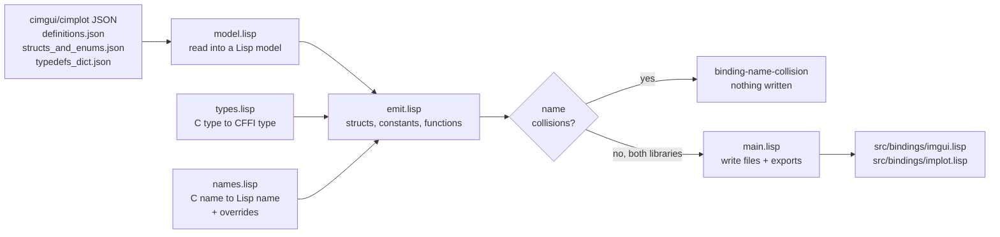

# generator/: the binding generator

Contents:

1. [What it is](#what-it-is)
2. [Why a custom generator](#why-a-custom-generator)
3. [Running it](#running-it)
4. [How it works](#how-it-works)
5. [The output](#the-output)
6. [Maintenance](#maintenance)
7. [Gotchas](#gotchas)
8. [Tests](#tests)

## What it is

A small Lisp program, about 700 lines, that writes the Lisp bindings to Dear ImGui and ImPlot. It reads the JSON descriptions that cimgui and cimplot ship with their generated C code, and writes two files of plain CFFI definitions:

| Output | Package | Source |
| --- | --- | --- |
| `src/bindings/imgui.lisp` (~14,000 lines) | `%imgui` | `native/third_party/cimgui/generator/output/*.json` |
| `src/bindings/implot.lisp` (~5,500 lines) | `%implot` | `native/third_party/cimplot/generator/output/*.json` |

The rest of sc-imgui calls ImGui and ImPlot through these files.

The generator runs **only** when you run `make bindings`, normally right after moving the cimgui or cimplot pins. It's a separate ASDF system, `sc-imgui/generator`, which the main `sc-imgui` system doesn't load. The generated files are committed, so loading or using sc-imgui never needs the generator or the JSON.

## Why a custom generator

cimgui's JSON exists so that bindings for other languages can be generated from it. It has already solved what makes ImGui hard to bind from C: it flattens C++ overloads into distinct, named C functions, describes templates, records enum values as numbers, and lists every typedef. What remains is mostly translation, which is why the generator is small and depends only on a JSON parser (`com.inuoe.jzon`).

The alternatives cost more:

- **c2ffi with cl-autowrap** needs a Clang-based tool built against a matching LLVM version, produces platform-specific output, and generates definitions at compile time, leaving no file to review.
- **claw**, and the old bodge ImGui bindings built with it, are unmaintained and target an ImGui version years old.
- **SWIG's** CFFI support is old and little used.

A custom generator also makes project-specific choices easy: how `bool` is passed, `nil` as a NULL string, and ImPlot reusing ImGui's structs. The cost is that you maintain it. This decision is also recorded in the decision log in `native/README.md`.

## Running it

```sh
make bindings
```

This starts SBCL, loads `sc-imgui/generator` through Quicklisp, and calls `(sc-imgui.generator:generate-bindings)`. From a REPL:

```lisp
(ql:quickload :sc-imgui/generator)
(sc-imgui.generator:generate-bindings)
```

`generate-bindings` takes keyword arguments `:cimgui-dir`, `:cimplot-dir`, and `:output-dir`, which default to the submodules and `src/bindings/`.

It emits both libraries first and writes the two files only if both succeed. If either library has a [name collision](#name-collisions-are-errors), it stops with `binding-name-collision` and writes nothing, so `src/bindings/` stays exactly as it was.

When it does write, it prints any warnings, then a summary line per library:

```
cimgui: <n> forms written to .../src/bindings/imgui.lisp (<n> functions skipped, <n> opaque structs)
```

**Keep these numbers from one run to the next.** A jump in skipped functions or opaque structs after an upgrade is the earliest sign that something needs attention. See [Maintenance](#maintenance).

The warnings to look for are `opaque-struct-warning` (a struct emitted without slots) and `unused-name-override` (an entry in `*lisp-name-overrides*` that matched nothing). Neither stops the files being written.

Run it in a fresh SBCL, as `make bindings` does, so it doesn't write over the packages of a running sc-imgui session.

## How it works



### Input: cimgui's three JSON files

All three live in each wrapper's `generator/output/` directory.

| File | What the generator reads from it |
| --- | --- |
| `definitions.json` | Every function, keyed by C++ name, with one entry per overload. Uses `ov_cimguiname` (the unique C name, such as `igGetID_Str`), `argsT` (argument names and types), `ret`, `isvararg`, `constructor`, and `templated`. |
| `structs_and_enums.json` | `structs` (fields with `name`, `type`, `size`, `bitfield`), `enums` (values with `calc_value`), `enumtypes`, and the template tables `templated_structs`, `templates_done`, and `typenames`. |
| `typedefs_dict.json` | Every typedef, such as `ImGuiWindowFlags` → `int` or `ImU32` → `unsigned int`. |

### `model.lisp`: read the JSON into a model

`load-model` returns a plist `(:functions :structs :enums :typedefs)`:

- **Functions:** one entry per overload, named by `ov_cimguiname`. cimgui omits `ret` on constructors and some destructors; constructors are treated as returning `void*`, and the rest as `void`. `...` arguments are dropped and the function marked variadic.
- **Structs:** fields as listed, including array sizes and bitfield markers.
- **Templates:** cimgui describes templates such as `ImVector<T>` generically, and lists every instantiation it uses in `templates_done`. The generator builds a concrete struct for each instantiation of the templates in `*instantiated-templates*` (`ImVector`, `ImSmallStack_`, `ImSpan`), using cimgui's naming: `ImVector<ImDrawList*>` becomes `ImVector_ImDrawListPtr`. CFFI needs one definition per concrete type. Other templates stay opaque.
- **Enums:** each constant's numeric value comes from `calc_value`, which cimgui has already computed from expressions like `1 << 3`.
- **Typedefs:** every enum `E_` also becomes a typedef `E` for `int`, unless the typedef table says otherwise, and `enumtypes` gives the exact type of the rest.

### `types.lisp`: C types to CFFI types

`c-type->cffi` maps a C type string to a CFFI type, or returns `nil` when it can't:

| C type | CFFI type |
| --- | --- |
| scalars: `bool`, `int`, `unsigned int`, `float`, `double`, `char`, `short`, `long long`, `size_t`, ... | `:bool`, `:int`, `:uint`, `:float`, `:double`, ... (`*scalar-types*`) |
| `ImU32`, `ImGuiID` | `:uint32`, fixed before any typedef lookup |
| `const char*` | `:string` |
| any other pointer, or an array | `:pointer` |
| function pointer (contains `(*)`) | `:pointer` |
| a known struct by value | `(:struct name)` |
| `ImVec2`, `ImVec4` | always `(:struct im-vec2)`, `(:struct im-vec4)` |
| `Foo_c` (cimgui's layout-identical copy of a small struct) | the real struct `Foo` |
| a typedef | whatever its target maps to, followed up to 8 levels |
| `va_list`, other `(...)` types, unknown names | `nil`, so the function or struct can't be bound |

Leading `const` and `struct` are ignored.

### `names.lisp`: C names to Lisp names

`c-name->lisp-name` strips a prefix, splits CamelCase into hyphenated words, turns `_` into `-`, and lowercases. An uppercase letter starts a new word after a lowercase letter or digit, or when it ends a run of capitals followed by a lowercase letter.

| C name | Prefix | Lisp name |
| --- | --- | --- |
| `igSliderFloat2` | `ig` | `slider-float2` |
| `igGetIO_Nil` | `ig` | `get-io-nil` |
| `igBeginChild_Str` | `ig` | `begin-child-str` |
| `ImPlot_PlotLine_FloatPtrInt` | `ImPlot_` | `plot-line-float-ptr-int` |
| `ImGuiWindowFlags_NoTitleBar` | `ImGui` | `+window-flags-no-title-bar+` (constants get `+...+`) |
| `ImVec2` | none | `im-vec2` (struct names keep their prefix) |

**Overrides.** The rest of the generator doesn't call `c-name->lisp-name` directly. It calls `binding-lisp-name`, which first checks `*lisp-name-overrides*`, an alist of `(C-NAME . LISP-NAME)`, and uses the override when there is one. Overrides apply to functions, enum constants, and structs. They exist to resolve [name collisions](#name-collisions-are-errors) deliberately, and the list is empty unless a collision has needed one. One table serves both libraries, keyed by C name only.

### `emit.lisp`: build the forms

`emit-forms` produces structs first, then constants, then functions.

**Structs** (`build-structs`). Each struct is either *complete*, with slots, or *opaque*, with no slots, which can only be used through pointers. A struct becomes opaque, with an `opaque-struct-warning`, if any field is a bitfield, has an unmappable type, is an array of unknown size, or produces a duplicate slot name. Structs are resolved recursively, so a struct used by value is always emitted after the structs it contains. C `bool` fields are stored as one-byte booleans (`(:boolean :uchar)`), because CFFI's `:bool` is the size of an `int`.

**Constants.** One `defconstant` per enum value with an integer `calc_value`. Values without an integer are skipped.

**Functions** (`emit-function`). One `defcfun` per function, except in these cases:

- **Skipped:** variadic functions, templated functions, functions with an unmappable return or argument type, and functions with two arguments that get the same Lisp name. Skips are counted in the summary but not printed individually. (`emit-forms` returns the list, with a reason for each, as its second value.)
- **The `bool` rule.** Every function with a C `bool` return or argument becomes two definitions: `NAME-RAW`, a `defcfun` using `:uint8` for each `bool`, and `NAME`, a small `defun` that takes and returns `t`/`nil`. Only `NAME` is exported. This is because C `bool` is one byte while CFFI's `:bool` is `int`-sized, and cffi-libffi, which CFFI uses for calls that pass a struct by value, can't translate a `:bool` argument or a custom return type.
- **String arguments.** Every `const char*` argument uses `sc-imgui.bindings:optional-string`, defined in `src/bindings/types.lisp`. It's CFFI's `:string`, except that `nil` passes NULL, which many optional ImGui arguments need. Return values stay `:string`.

**Collision check.** As it goes, `emit-forms` records which C names claim each Lisp symbol: struct names, constant names, and function names, where a `bool` function claims both `NAME` and `NAME-RAW`. If any symbol is claimed by more than one C name, it signals a single `binding-name-collision` listing every collision, after checking all three kinds. See [Name collisions are errors](#name-collisions-are-errors).

**Exports** (`forms-exports`). Every function name (the wrapper, not the `-raw` function) and every constant.

### `main.lisp`: write the files

Generation is split into two steps so nothing is written until both libraries are known to be good:

- `emit-library` loads one library's model and emits its forms, writing nothing.
- `write-library` writes one file: a header with the source commit from `git rev-parse HEAD` in the submodule, an `in-package`, every form, and a final `export` of all public names. Files are written with a 100-column print margin and lowercase symbols. It then prints the summary line.

`generate-bindings` emits both libraries, then warns about unused overrides, then writes both files. It emits:

1. **cimgui into `%imgui`,** stripping `ig` from functions and `ImGui` from enum constants.
2. **cimplot into `%implot`,** stripping `ImPlot_` from functions and `ImPlot` from enum constants, with these differences:
    - **Strict prefix:** only functions starting with `ImPlot_` are emitted. cimplot's JSON also lists ImGui functions.
    - **Name prefixes:** only structs and enums starting with `ImPlot` or `ImAxis` are emitted.
    - **External structs:** ImPlot functions that use ImGui structs by value, such as `ImVec2`, refer to the complete structs already defined in `%imgui` instead of redefining them.
    - **Fallback typedefs:** cimgui's typedefs fill in types that cimplot's own table lacks.

## The output

Each generated file is a list of plain CFFI forms in a package that doesn't use `CL`, which is why standard symbols are printed with prefixes such as `common-lisp:defconstant`:

```lisp
;;; GENERATED by generator/main.lisp; do not edit.
;;; cimgui commit: 5d7cc7e12de9a868bbecc00ce2ed74e58d266f1c
(in-package #:%imgui)

(cffi:defcstruct im-vec2 (x :float) (y :float))
(common-lisp:defconstant +window-flags-no-title-bar+ 1)
(cffi:defcfun ("igBegin" begin-raw) :uint8 (name sc-imgui.bindings:optional-string) ...)
(common-lisp:defun begin (name p-open flags) (common-lisp:/= 0 (begin-raw name p-open flags)))
```

At the current pins, the output contains:

| | Foreign functions | of which with `bool` wrappers | Structs | of which opaque | Constants |
| --- | --- | --- | --- | --- | --- |
| `imgui.lisp` | 1,594 | 332 | 206 | 18 | 1,076 |
| `implot.lisp` | 601 | 74 | 26 | 9 | 254 |

The opaque structs are internal types the code doesn't read, such as `im-gui-context`, `im-gui-table`, `im-gui-dock-node`, and `im-plot-plot`.

**Loading order matters.** The generated files refer to `sc-imgui.bindings:optional-string`, so `src/bindings/types.lisp` must load before them. The `sc-imgui/bindings` system arranges this.

## Maintenance

### When the cimgui or cimplot pins move

Follow "Upgrading the third-party libraries" in `native/README.md`. The generator-specific part:

1. **Run `make bindings`.**
    - If it stops with `binding-name-collision`, the new JSON has introduced a collision. Nothing was written, so the old bindings are still in place. Resolve each collision as described in [Name collisions are errors](#name-collisions-are-errors), then run it again.
    - If it warns with `unused-name-override`, an override no longer matches anything. Remove it, and if the C name was renamed upstream, check whether the collision still exists under the new name.
    - Compare the summary with the previous run's: forms written, functions skipped, opaque structs.
2. **Read the other warnings.** A new opaque struct matters if the code reads its fields. The structs whose fields are read directly are `im-gui-io`, `im-draw-list`, `im-vector-im-draw-vert`, `im-vec2`, and `im-vec4` (see `tests/README.md`). If one of them becomes opaque, find out why: usually a new field type `types.lisp` can't map, or a new bitfield.
3. **Review the diff** of `src/bindings/`. It's effectively the API changelog from Lisp's point of view:

    ```sh
    git diff --stat src/bindings/
    git diff src/bindings/imgui.lisp | grep '^-(cffi:defcfun'    # removed or renamed functions
    ```

    For each removed or renamed function, search `src/`, `tests/`, and `examples/` for its Lisp name.
4. **Run `make test`,** not instead of reading the diff but after it. The generator tests use hand-written fixtures, so a change in cimgui's JSON format shows up only in steps 1 to 3.
5. **Commit the regenerated files** together with the new pins and any new overrides, so they never disagree.

### When cimgui changes its JSON format

The generator reads specific keys: `ov_cimguiname`, `argsT`, `ret`, `isvararg`, `constructor`, `templated`, `calc_value`, `bitfield`, `size`, `templated_structs`, `templates_done`, `typenames`, and `enumtypes`. If cimgui renames or restructures any of these, the generator may silently produce fewer forms rather than fail. Watch for a sudden drop in the summary counts. Fix the reader in `model.lisp`, then update `tests/fixtures/` to the new format so the generator tests cover it.

### Supporting a new type

When an important function is skipped or a struct becomes opaque because of an unmappable type:

- For a new scalar or fixed-width type, add it to `*scalar-types*` in `types.lisp`.
- For a new template that cimgui instantiates as a plain C struct, add it to `*instantiated-templates*` in `model.lisp`.
- For a struct that must always be mappable by value, add it to `*builtin-structs*`.

Then add a fixture entry and a test in `tests/test-generator.lisp`, regenerate, and review the diff.

### Changing the naming rule

Avoid it. The naming rule determines every Lisp name in the bindings, and the `gui` layer, tests, and examples all depend on those names. A change renames thousands of functions at once. To change one name, use an entry in `*lisp-name-overrides*` instead. If a rule change is ever necessary, do it in a commit of its own, regenerate, and fix every caller in the same commit. `tests/fixtures/expected-imgui.lisp` will need regenerating too (see [Tests](#tests)).

## Gotchas

### Never edit the generated files

`imgui.lisp` and `implot.lisp` are completely rewritten by every `make bindings`. A hand edit is lost the next time anyone regenerates. Change the generator instead, or put hand-written bindings in their own file in `src/bindings/`, as `shim.lisp` does.

### Overload suffixes can change between versions

When ImGui has several functions with the same name, cimgui gives each a suffix based on its arguments, such as `_Str`, `_Int`, or `_Vec2`. When ImGui adds an overload, a function that had no suffix gains one: `igGetIO` became `igGetIO_Nil` when ImGui added a version taking a context. The Lisp name changes with it (`get-io` became `get-io-nil`), and every caller breaks. These renames are the most common upgrade breakage. Look for them first in the diff.

### Enum constant prefixes aren't uniform

Only `ImGui` (for `%imgui`) and `ImPlot` (for `%implot`) are stripped from constant names. Enums with other prefixes keep them: `ImGuiWindowFlags_NoTitleBar` becomes `+window-flags-no-title-bar+`, but `ImDrawFlags_None` becomes `+im-draw-flags-none+`. Check the generated file for the exact name before using a constant. `gui:enum-flags` relies on this rule when it looks constants up by prefix.

### Name collisions are errors

The naming rule erases some differences. `igFooIO` and `igFoo_IO` both become `foo-io`. Every function with a C `bool` return or argument also takes a second name, `NAME-RAW`, for its raw `defcfun`, so a C function called `igFooRaw` would collide with the raw function of a bool-returning `igFoo`.

If two C names map to one Lisp symbol, `emit-forms` signals `binding-name-collision`. That covers two functions, a function and another function's `NAME-RAW`, two enum constants (even with equal values), and two structs. It gathers every collision first, then signals a single error. The report gives each Lisp symbol and every C name that maps to it. From code, `binding-name-collisions` returns the list, and `collision-kind`, `collision-lisp-name`, and `collision-c-names` read each entry.

**Why it's an error.** The generator used to keep the first name and skip the second, counting it only in the summary. After an upgrade, an existing Lisp name could then have silently pointed at a different C function, so calls would go to the wrong function with no error. There are no collisions at the current pins; this only fires when an upgrade introduces one.

**Resolving a collision** with `*lisp-name-overrides*` in `names.lisp`:

1. **Decide which C name keeps the Lisp name.** Usually it's the one that had the name before the upgrade, because existing code relies on it. Diffing `src/bindings/` against the previous pins shows which one that is.
2. **Rename the other one** by adding an entry. Give the Lisp name in the form `c-name->lisp-name` returns. Leave out the prefix (`ig`, `ImPlot_`, `ImGui`), the `+...+` around constants, and the `-raw` suffix, because the generator adds those itself:

    ```lisp
    (defparameter *lisp-name-overrides*
      '(("igFoo_IO" . "foo-io-by-index")                    ; function: foo-io stays with igFooIO
        ("ImGuiFlags_No_Title" . "flags-no-title-legacy"))) ; constant: +flags-no-title-legacy+
    ```

3. **Add a test** in `tests/test-generator.lisp` that reproduces the collision with the real C names, adding fixture entries if needed, and checks that the override resolves it. Then run `make bindings` and `make test`, and read the diff of the bindings.

How each kind of collision is resolved:

- **Function:** the override renames that function. For a function with a `bool` return or argument, it renames both the wrapper and its `NAME-RAW`. So for `igFooRaw` colliding with `igFoo`'s `foo-raw`, rename either `igFooRaw` or `igFoo`.
- **Constant:** rename one of the two, even when their values are equal. One may be a deprecated alias, and keeping it under its own name is a choice you can see in the code.
- **Struct:** the override applies wherever the struct is referred to (its `defcstruct`, struct fields, and by-value arguments), so nothing still uses the old name.

### Overrides can go stale

Overrides are keyed by C name only, and both libraries share one table. If cimgui later renames or drops an overridden C name, or the generator starts skipping it, the override matches nothing. `make bindings` then warns with `unused-name-override` and still writes the files. Remove the entry, and if the C name was renamed, check whether the collision still exists under the new name.

### `bool` always goes through a wrapper

Every function with a `bool` return or argument has a `-raw` version taking `:uint8`, and a wrapper. Call the wrapper (`%imgui:begin`), not `%imgui:begin-raw`. Only the wrapper is exported. The `-raw` functions exist only because of the size mismatch and cffi-libffi limitation described in [How it works](#emitlisp-build-the-forms).

### `const char*` arguments depend on `sc-imgui.bindings`

The generator writes `sc-imgui.bindings:optional-string` into every function with a string argument, and creates and exports that symbol while generating. If `optional-string` is renamed or moved in `src/bindings/types.lisp`, the generator must change too.

### Templated and variadic functions are never bound

Functions like `igText` (variadic, `printf`-style) and template member functions are skipped by design. The `gui` layer uses non-variadic equivalents instead, such as `igTextUnformatted` for `gui:text`.

### The commit header needs `git`

The header records the submodule's commit using `git rev-parse HEAD`. If `git` isn't available, or the submodule directory isn't a git checkout, such as an extracted archive, the header says `commit: unknown`. The bindings are still correct, but you lose the record of which commit they came from.

### Run it in a fresh Lisp

`generate-bindings` creates the `%imgui` and `%implot` packages if they don't exist and interns symbols in them. Running it in a Lisp that has sc-imgui loaded works, but adds to live packages. `make bindings` always uses a fresh SBCL.

## Tests

The `generator` suite in `tests/test-generator.lisp` (25 tests) runs the generator without loading ImGui. It covers:

- naming, type mapping, skipping variadic functions, opaque structs, the `bool` rule, `nil` strings, struct ordering, ImPlot's reuse of `%imgui` structs, exports, and prefix filtering, using the hand-written JSON in `tests/fixtures/`;
- **output stability:** `fixture-output-unchanged` checks that the fixtures still produce `tests/fixtures/expected-imgui.lisp` byte for byte. That file is the output from before collisions became errors. If you change the generator's output on purpose, regenerate it and review its diff;
- **name collisions:** each kind of collision signals `binding-name-collision`, including a function named like another's `NAME-RAW`; one error lists every collision; and an override resolves each kind. These inputs are built inline in the test file, not taken from the fixtures;
- **unused overrides:** `unused-name-override` is signalled for an override that matches nothing, and not for one that's used;
- **all or nothing:** `generate-bindings`, run on temporary JSON with a collision in cimplot, writes neither file.

**The fixtures are not real cimgui output** and don't change when cimgui does. A change in cimgui's JSON format won't fail these tests. It shows up only when `make bindings` runs on the real files. After an upgrade, read the summary, warnings, and diff, not just the test results. The `bindings` suite then checks the real generated code through actual calls into the library.

Run the generator tests with:

```sh
make test SUITE=generator
```
