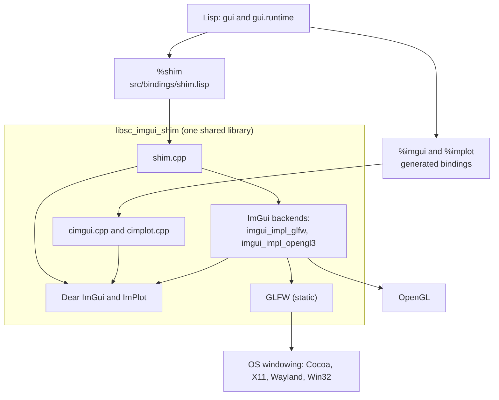
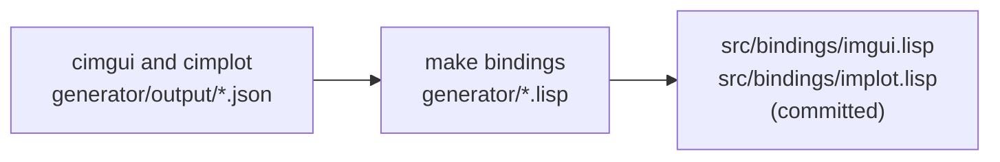

# native/: the C++ shim and third-party libraries

This folder builds one shared library, `libsc_imgui_shim` (`.dylib` on macOS, `.so` on Linux, `.dll` on Windows). It contains Dear ImGui, ImPlot, their C wrappers cimgui and cimplot, ImGui's stock GLFW and OpenGL 3 backends, GLFW itself, and a small shim of our own. Everything else in sc-imgui is Lisp that loads this library.

Contents:

1. [Overview](#overview)
2. [How the pieces fit](#how-the-pieces-fit)
3. [Building](#building)
4. [File by file](#file-by-file)
5. [The submodules](#the-submodules)
6. [Gotchas](#gotchas)
7. [Upgrading the third-party libraries](#upgrading-the-third-party-libraries)
8. [Checking that the pins match](#checking-that-the-pins-match)
9. [Adding a new shim function](#adding-a-new-shim-function)
10. [Changing the backend](#changing-the-backend)
11. [Troubleshooting](#troubleshooting)
12. [Decision log](#decision-log)

## Overview

Almost all of ImGui and ImPlot is called from Lisp directly. cimgui and cimplot expose them as plain C functions, and `src/bindings/imgui.lisp` and `src/bindings/implot.lisp` bind those functions. The bindings are generated from JSON descriptions that cimgui and cimplot ship.

The shim (`shim.h` and `shim.cpp`) covers only what cimgui doesn't: creating and showing the window, driving each frame through ImGui's C++ backends, a headless mode for tests, and recording ImGui assertions instead of aborting. Lisp binds the shim's functions in `src/bindings/shim.lisp` as the `%shim` package.

The design keeps every platform-specific detail (OpenGL versions, GLFW setup, framebuffer sizes) in battle-tested backend code. The Lisp side only calls a handful of functions like `begin-frame` and `end-frame`.

## How the pieces fit

At run time:



At generation time, which happens only when the pins change:



## Building

**Prerequisites:**

- **macOS:** Xcode command-line tools (`xcode-select --install`) and CMake (for example, `brew install cmake`).
- **Linux (Debian/Ubuntu):** `build-essential cmake pkg-config`, plus the headers GLFW 3.4 needs for its X11 and Wayland backends: `libgl1-mesa-dev libx11-dev libxrandr-dev libxinerama-dev libxcursor-dev libxi-dev libwayland-dev libxkbcommon-dev`. `.github/workflows/ci.yml` has the full, tested list. The Lisp side also needs `libffi-dev` for cffi-libffi.

**Steps:**

```sh
git submodule update --init native/third_party/{imgui,cimgui,implot,cimplot,glfw}
make native
```

`make native` runs three CMake commands:

```sh
cmake -S native -B native/build -DCMAKE_BUILD_TYPE=Release   # configure
cmake --build native/build                                   # compile
ctest --test-dir native/build --output-on-failure            # run test_assert
```

The library ends up in `native/build/`, which git ignores. Lisp looks for it in this order (`src/bindings/library.lisp`):

1. the directory in the environment variable `SC_IMGUI_LIB`, if set
2. `native/build/`
3. `native/build/Release/` (used by multi-configuration generators such as Visual Studio)

If none has it, loading the system signals `shim-library-not-found`, which lists every path tried.

## File by file

### `CMakeLists.txt`

Builds the shared library and the C test. CMake is used for three reasons:

- **ImGui and ImPlot have no build system.** They expect you to compile their `.cpp` files as part of your own project, so something has to list the files, set include paths, and apply our compile definitions.
- **GLFW ships a CMake build.** `add_subdirectory` reuses its platform detection for Cocoa, X11, Wayland, and Win32, and links GLFW statically. Reproducing that by hand with plain `make` would be the hardest part to maintain.
- **One file covers every platform:** the right library suffix, the right OpenGL linking, and `ctest` for the C test.

Notable settings:

| Setting | Why |
| --- | --- |
| `CMAKE_CXX_STANDARD 14` | What ImGui and ImPlot require. |
| `CMAKE_POSITION_INDEPENDENT_CODE ON` | Required for a shared library that bundles the static GLFW. |
| `CMAKE_C_VISIBILITY_PRESET default`, `CMAKE_CXX_VISIBILITY_PRESET default` | Exports every symbol, so Lisp can call any cimgui or cimplot function. |
| `BUILD_SHARED_LIBS OFF`, `GLFW_BUILD_* OFF` | Builds GLFW as a static library inside ours, without its examples, tests, docs, or install step. |
| `IMGUI_USER_CONFIG="sc_imgui_config.h"` (`PUBLIC`) | Applies our ImGui configuration to every compiled file and to `test_assert.c`. See [`sc_imgui_config.h`](#sc_imgui_configh). |
| `IMGUI_IMPL_API=extern "C"` | How cimgui expects to be compiled. Gives its functions C linkage, so they keep plain, unmangled names. |
| `IMGUI_DISABLE_OBSOLETE_FUNCTIONS=1` | Removes deprecated ImGui functions, so breaking changes show up immediately at upgrade time. |
| `GL_SILENCE_DEPRECATION` (macOS) | Silences Apple's OpenGL deprecation warnings. OpenGL still works. |
| `-framework OpenGL` (macOS), `OpenGL::GL` (elsewhere) | OpenGL linking. GLFW's own target adds the other frameworks it needs (Cocoa, IOKit). |

`imgui_demo.cpp` and `implot_demo.cpp` are compiled too, so `%imgui:show-demo-window` and ImPlot's demo are available from the REPL. They're useful for exploring widgets. Removing them would shrink the library slightly.

### `shim.h`

The contract between Lisp and the shim: seventeen C functions, all declared `extern "C"`. `src/bindings/shim.lisp` binds exactly these. Each declaration's comment states its return values and which thread may call it.

### `shim.cpp`

The implementation. It does four jobs.

**1. Window and frame lifecycle.** The frame loop in `src/runtime/loop.lisp` calls these. All run on the main thread.

| Function | What it does |
| --- | --- |
| `shim_open_window` | Starts GLFW, requests OpenGL 3.2 core forward-compatible with GLSL `#version 150` on macOS (3.0 with `#version 130` elsewhere), creates the window, turns on vsync, creates the ImGui and ImPlot contexts, enables docking and error recovery, sets the `.ini` path (the string is copied), and starts the GLFW and OpenGL 3 backends. Returns 0 on success; otherwise `shim_last_error` gives the reason. |
| `shim_begin_frame` | Polls input events and starts a new ImGui frame. |
| `shim_end_frame` | Renders ImGui's draw data with OpenGL and swaps buffers. |
| `shim_should_close` | 1 once the user has pressed the close button. |
| `shim_show_window` | Shows the window, optionally setting a new title. |
| `shim_hide_window` | Saves the `.ini` layout, hides the window, and clears the close flag. `gui:stop` and the close button use this. |
| `shim_wait_events` | Sleeps until an event arrives or the timeout passes. The loop uses this while the window is hidden. |
| `shim_wake` | Wakes `shim_wait_events`. Callable from **any** thread. |
| `shim_shutdown` | Full teardown for `gui:shutdown`: hides the window if visible, keeps processing events until 0.5 s after the hide (see [Gotchas](#macos-the-window-must-leave-the-screen-before-it-is-destroyed)), then destroys the backends, contexts, and window, and terminates GLFW. |
| `shim_last_error` | Message for the last nonzero return, or `""`. |

**2. Headless mode for tests.** `shim_headless_create` sets up ImGui with no window or GPU: a fixed display size, a frame time of 1/60 s, no `.ini` file, and two backend flags (see [Gotchas](#headless-mode-depends-on-two-backend-flags)). `make test` runs with this, so it works on CI with no display. `shim_headless_destroy` undoes it.

**3. Recorded assertions.** `sc_imgui_assert_failed` is what `IM_ASSERT` calls. It counts the failure and stores `"expr @ file:line"` instead of aborting the process. `shim_assert_count`, `shim_last_assert`, and `shim_clear_asserts` let tests read and reset the record.

**4. Test helpers.** `shim_window_visible` (1, 0, or -1 when there's no window) and `shim_test_request_close`, which sets the close flag the way the close button does and may be called from any thread. The smoke test uses both, on every platform.

Internal details worth knowing:

- `g_wake_mutex` guards the window pointer, because `shim_wake` and `shim_test_request_close` can run on other threads while the main thread destroys the window. GLFW allows `glfwPostEmptyEvent` from any thread, but not at the same time as `glfwTerminate`.
- `g_last_assert`, `g_last_error`, and `g_ini_path` are static `std::string`s, so the `const char *` values returned to Lisp stay valid after the call.

### `sc_imgui_config.h`

ImGui's user configuration header. It contains only the declaration of `sc_imgui_assert_failed` and this definition:

```c
#define IM_ASSERT(e) do { if (!(e)) sc_imgui_assert_failed(#e, __FILE__, __LINE__); } while (0)
```

It has to be a separate header. The assertions that matter fire inside ImGui's own source files (`imgui.cpp`, `imgui_widgets.cpp`, ImPlot, cimgui, and the backends), and each file decides what `IM_ASSERT` means when it includes `imgui.h`. ImGui's official hook is the macro `IMGUI_USER_CONFIG`: when it names a header, `imgui.h` includes that header before its own defaults. CMake sets it for every file in the library. Putting the definition in `shim.cpp` alone would leave every ImGui file using the standard `assert`, which aborts the process and takes the SBCL session with it.

The alternative, editing ImGui's own `imconfig.h`, would mean changing a file inside the `imgui` submodule, which is easy to lose at upgrade time. Any other ImGui compile-time option belongs in this file too.

The header works from both C and C++, because `test_assert.c` sees it through the `PUBLIC` compile definition.

### `test_assert.c`

The C test run by `ctest`. It creates a headless context, calls `igEnd()` without a matching `igBegin()`, and checks that the misuse was recorded and the record can be cleared, all without the process aborting. If this test fails, ImGui misuse can crash SBCL.

### `build/`

CMake's output, ignored by git. Delete it to force a clean rebuild, for example after changing compilers or CMake options.

### `third_party/`

The pinned submodules, described next.

## The submodules

| Submodule | Role | Pinned commit | Compiled files |
| --- | --- | --- | --- |
| `imgui` | Dear ImGui, docking branch | `d88f238` (2026-10-15) | `imgui.cpp`, `imgui_draw.cpp`, `imgui_tables.cpp`, `imgui_widgets.cpp`, `imgui_demo.cpp`, `backends/imgui_impl_glfw.cpp`, `backends/imgui_impl_opengl3.cpp` |
| `cimgui` | C wrapper for ImGui, plus the JSON used to generate `imgui.lisp` | `5d7cc7e` (2026-10-16), branch `docking_inter` | `cimgui.cpp` |
| `implot` | ImPlot | `72de278` (2026-10-25) | `implot.cpp`, `implot_items.cpp`, `implot_demo.cpp` |
| `cimplot` | C wrapper for ImPlot, plus the JSON used to generate `implot.lisp` | `c809ff2` (2026-10-26) | `cimplot.cpp` |
| `glfw` | Windowing and input | `7b6aead` (tag 3.4) | built by its own CMake, statically |

The full commit hashes and dates are also in the top-level `README.md`. The pins are recorded in the repository itself, so `git submodule update --init` always checks out exactly these commits.

**Only one copy of ImGui and ImPlot is compiled.** cimgui and cimplot each contain their own nested submodule (`cimgui/imgui` and `cimplot/implot`). Those are **not** initialised. `cimgui.cpp` includes `"./imgui/imgui.h"`, and `cimplot.cpp` includes `"./implot/implot.h"`. Because `third_party/` itself is on the include path, those includes resolve to our top-level `third_party/imgui` and `third_party/implot`. That's why the top-level pins must equal the commits the wrappers were generated from.

## Gotchas

### ImGui and cimgui, and ImPlot and cimplot, must match exactly

cimgui's generated C code and JSON describe one exact ImGui commit. If ImGui is pinned to a different commit, the compiled library and the Lisp bindings disagree about function signatures and struct layouts. **The result is crashes or memory corruption, not errors.** The same applies to ImPlot and cimplot. Always pin ImGui to the commit recorded inside the chosen cimgui commit, and likewise for ImPlot. [Checking that the pins match](#checking-that-the-pins-match) shows how to verify this.

### cimgui's `docking_inter` head may not contain docking

At the time of pinning, the newest commit on `docking_inter` (`2a6a93f`) had been generated from **non-docking** ImGui: no `ImGuiConfigFlags_DockingEnable`, no dock API. `5d7cc7e` is the newest commit whose output contains docking. Before adopting any cimgui commit, check:

```sh
git -C native/third_party/cimgui show <sha>:generator/output/definitions.json | grep -c igDockSpace
```

The count must be greater than zero.

### `git submodule update --remote` breaks the pins

`git submodule update --remote` moves each submodule to the newest commit on a branch. For this project that is always wrong, because ImGui and cimgui (and ImPlot and cimplot) must move together to a matched pair, chosen as described in [Upgrading](#upgrading-the-third-party-libraries). For `cimgui`, the newest commit may even be the broken head described above. **Don't use `--remote`.**

`.gitmodules` used to name a branch for `imgui` (`docking`) and `cimgui` (`docking_inter`), which `--remote` would have followed. Those settings are now comments: they still record which branch each pin comes from, but no git command acts on them. Without them, `--remote` would follow each repository's default branch, which is still wrong, so the rule above stands. Don't turn the comments back into `branch =` settings.

### Don't initialise the nested submodules

`git submodule update --init --recursive` would check out `cimgui/imgui` and `cimplot/implot`. The build doesn't use them, so nothing breaks, but it suggests that more copies are involved than there are, and it doubles the checkout. Initialise only the five top-level submodules, as in [Building](#building).

### The generated bindings must be regenerated when the pins move

`src/bindings/imgui.lisp` and `implot.lisp` are committed, so loading the system never needs the generator. They're only correct for the pinned cimgui and cimplot. After changing those pins, run `make bindings` and commit the result together with the new pins.

### Separate targets don't get `IMGUI_USER_CONFIG` automatically

Every file that includes `imgui.h` (the ImGui, ImPlot, cimgui, cimplot, backend, and shim sources) must see the same `IMGUI_USER_CONFIG`, or it falls back to ImGui's aborting `assert`. Within the library this is automatic: the definition is set on the `sc_imgui_shim` target, so any source file added to its `add_library` list gets it. You might add files after an upgrade that splits ImGui or ImPlot into new files, or to include a new backend, ImGui's optional extras (`misc/cpp/imgui_stdlib.cpp`, `misc/freetype/imgui_freetype.cpp`), or an extension library.

The risk is a **separate target** that compiles ImGui or ImPlot sources itself, such as a new test program or a second library. It doesn't inherit the definition unless it links `sc_imgui_shim` (which passes it on, since it's `PUBLIC`) or sets it explicitly. Without it, asserts in that target's copy of ImGui abort the process. Prefer linking `sc_imgui_shim` over recompiling ImGui sources.

### A failed ImGui assertion no longer aborts the process, but it can still lead to a crash

**When they fire.** ImGui's assertions are checks inside its C++ code that run while frames are drawn, so they fire during your Lisp session, when a panel's draw code calls ImGui incorrectly. Typical causes:

- an `End` without a matching `Begin`, or other unbalanced begin/end and push/pop pairs
- a table, plot, or combo function called outside its matching begin/end
- a widget function called outside a frame
- invalid arguments, such as a null label

The `gui` scope macros keep begin/end pairs balanced even when your code signals an error, so these mostly come from raw `%imgui` or `%implot` calls in a panel, or from a bug in the `gui` layer itself.

**Why continuing matters.** Without our `IM_ASSERT`, a failed check would abort the process and lose your SBCL session. With it, the failure is recorded and ImGui carries on past the check. Usually that's harmless, and ImGui's `ConfigErrorRecovery`, enabled in `configure_io`, repairs common mistakes such as a missing `End` at the end of the frame. But some checks exist to guard against something like a null pointer or an out-of-range index. Continuing past one of those can still crash the process or leave ImGui's internal state corrupted. So treat any recorded assertion as a bug to fix, not a warning to ignore.

**Live sessions don't report them yet.** The tests check `assert-count` after each scenario, but the frame loop doesn't, so during a live session a failed assertion is recorded silently. If ImGui behaves oddly, check `(%shim:assert-count)` and `(%shim:last-assert)` in the REPL, which gives the failing expression and its file and line, then `(%shim:clear-asserts)`. A possible improvement is for the frame loop to report each new assertion to `*report-stream*`, the same way it reports panel errors.

### `IMGUI_DISABLE_OBSOLETE_FUNCTIONS` makes deprecations fail immediately

When ImGui deprecates a function, it normally keeps it for a while. With this flag, it disappears immediately. That's intentional, so an upgrade surfaces every needed change at once. But expect `make bindings` output and Lisp code that uses old names to need updating at upgrade time.

### Headless mode depends on two backend flags

`shim_headless_create` sets `ImGuiBackendFlags_RendererHasTextures`, because ImGui 1.92 and later build the font atlas lazily, and only when the renderer claims dynamic texture support. It also sets `ImGuiBackendFlags_RendererHasVtxOffset`, because the OpenGL 3 backend sets it in production, and without it ImGui asserts on large draw lists. If a future ImGui changes how fonts or textures work, headless tests failing at the first `NewFrame` is the symptom. Check ImGui's release notes for the new requirements.

### macOS: windows must be driven from the main thread

macOS only allows the process's main thread to drive windows. The frame loop therefore runs on SBCL's main thread. `gui:start` hands it over with `sb-thread:interrupt-thread`, which stays pending until the main thread accepts it, so the request is never lost. (An earlier version used `trivial-main-thread`, whose queue could lose a request when the main thread was slow to accept interrupts.) The REPL must evaluate on a different thread. Under SLIME, that needs `(setf swank::*main-thread-used* t)` in `~/.swank.lisp`. All shim functions except `shim_wake` and `shim_test_request_close` must be called on the main thread.

### macOS: the window must leave the screen before it is destroyed

On macOS, hiding or closing a window animates for about 0.25 s, driven by the main thread's event loop. If the window is destroyed and then nothing processes events, which is what happens when the frame loop ends and the main thread goes idle, the window stays frozen on screen with a spinning cursor.

The current design avoids this in two ways:

- **`gui:stop` and the close button hide the window rather than destroying it.** The loop keeps processing events, so the hide animation finishes normally.
- **`shim_shutdown` keeps processing events until 0.5 s after the window was hidden** (`HIDE_SETTLE`), and only then destroys it. This time was measured: 0.2 s was too short, and 0.3 s was enough. A fixed number of event passes doesn't work, because each pass returns immediately while events are queued.

This replaced an earlier Objective-C++ file, `shim_macos.mm`, that turned off the window animation and forced Core Animation to commit. **Don't destroy the window anywhere else without processing events first**, or the problem returns. If windows start lingering after `gui:shutdown` on a slower machine or a new macOS version, increase `HIDE_SETTLE`.

### OpenGL is deprecated on macOS

Apple deprecated OpenGL in 2018. It still works, including on Apple Silicon, and `GL_SILENCE_DEPRECATION` hides the warnings. If Apple ever removes it, the escape route is ImGui's Metal backend. See [Changing the backend](#changing-the-backend).

## Upgrading the third-party libraries

### Strategy

- **Upgrade for a reason:** a bug fix you need, a feature you want, or breakage on a new macOS version. Otherwise, upgrade on a slow schedule, once or twice a year. For a personal tool, tracking the newest version has no value.
- **Prefer cimgui commits generated from ImGui releases,** the ones titled "pull imgui docking 1.xx and generate". Avoid commits from between releases.
- **Wait about two weeks after a release** before adopting it, so obvious regressions are fixed first.
- **Upgrade one pair at a time:** ImGui with cimgui first, and get everything passing; then ImPlot with cimplot; then GLFW separately, if at all. If something breaks, you'll know which library caused it.
- **Read ImGui's "Breaking Changes" section** in the release notes for every version you skip over.
- **Let the tests do the work.** The headless suite catches API mismatches, the example tests catch anything the examples use, and the smoke test catches window and backend problems.

### Procedure

Work on a branch: `git switch -c upgrade-imgui`.

**1. Pick a cimgui commit and pin ImGui to match it.**

```sh
cd native/third_party/cimgui
git fetch origin
git log --oneline origin/docking_inter -15        # look for "pull imgui docking 1.xx and generate"
git checkout <cimgui-sha>
grep -c igDockSpace generator/output/definitions.json   # must be > 0
git ls-tree HEAD imgui                            # the ImGui commit it was generated from

cd ../imgui
git fetch origin
git checkout <imgui-sha-from-above>
cd ../../..
```

**2. Do the same for cimplot and ImPlot.**

```sh
cd native/third_party/cimplot
git fetch origin
git log --oneline origin/master -15               # cimplot's default branch
git checkout <cimplot-sha>
git ls-tree HEAD implot                           # the ImPlot commit it was generated from

cd ../implot
git fetch origin
git checkout <implot-sha-from-above>
cd ../../..
```

cimplot records its ImPlot commit but **not** the ImGui version it was generated against. ImPlot depends on ImGui, so choose a cimplot commit made after your chosen cimgui commit, and rely on the tests to confirm they work together.

**3. Verify the pins match.** Run the check in [Checking that the pins match](#checking-that-the-pins-match).

**4. Regenerate the bindings and inspect them.**

```sh
make bindings
git diff --stat src/bindings/
git diff src/bindings/ | less
```

The diff is the API changelog from Lisp's point of view. For every function that was removed or renamed, search the Lisp code for it (`grep -rn <name> src/ tests/ examples/`). Also read the generator's warnings: a struct the code relies on (`im-gui-io`, `im-draw-list`, `im-vector-im-draw-vert`, `im-vec2`, `im-vec4`) must not become opaque.

**5. Build and test.**

```sh
rm -rf native/build      # clean build after a pin change
make native
make test
make smoke
```

Then do a manual session in SLIME: `(gui:start)`, load each file in `examples/`, then `(gui:stop)`, `(gui:start)`, and `(gui:shutdown)`. On macOS, check that the window disappears immediately after `shutdown`.

**6. Record the upgrade.** Update the pin table in the top-level `README.md` and in [The submodules](#the-submodules) above, with commits and dates. Commit the submodule changes, regenerated bindings, any code fixes, and the README changes together, then merge.

### Checklist

- [ ] Reason for the upgrade noted; release notes and Breaking Changes read
- [ ] cimgui commit chosen; `igDockSpace` present in its `definitions.json`
- [ ] ImGui pinned to the commit recorded in cimgui
- [ ] ImPlot pinned to the commit recorded in cimplot; cimplot newer than cimgui
- [ ] Pin check passes
- [ ] `make bindings` run; diff reviewed; no needed struct became opaque
- [ ] Lisp code updated for removed or renamed functions
- [ ] `make native`, `make test`, `make smoke` all pass
- [ ] Manual SLIME session done, including `shutdown` on macOS
- [ ] Pin tables in `README.md` and `native/README.md` updated
- [ ] One commit containing pins, bindings, fixes, and docs

## Checking that the pins match

The pins can be compared automatically. Although the nested submodules aren't checked out, cimgui's and cimplot's own trees still record the commits they were generated from. A script along these lines, run by `make native` or in CI, would make a mismatched pair fail at build time instead of crashing at run time:

```sh
#!/bin/sh
# scripts/check-pins.sh: fail if a wrapper and its library are pinned apart.
set -e
pin()    { git ls-tree HEAD "$1" | awk '{print $3}'; }
nested() { git -C "$1" ls-tree HEAD "$2" | awk '{print $3}'; }

check() {  # check <library path> <wrapper path> <name inside wrapper>
  want=$(nested "$2" "$3"); have=$(pin "$1")
  if [ "$want" != "$have" ]; then
    echo "pin mismatch: $1 is $have but $2 was generated from $want" >&2
    exit 1
  fi
}

check native/third_party/imgui  native/third_party/cimgui  imgui
check native/third_party/implot native/third_party/cimplot implot

grep -q igDockSpace native/third_party/cimgui/generator/output/definitions.json || {
  echo "cimgui output has no docking API (igDockSpace missing)" >&2; exit 1; }

echo "pins OK"
```

This script isn't in the repository yet. Adding it is a small, separate change.

## Adding a new shim function

Use this when Lisp needs something cimgui doesn't expose, such as a GLFW call or a backend setting.

1. **Declare it in `shim.h`,** with a comment giving the return values and which thread may call it.
2. **Implement it in `shim.cpp`,** inside the `extern "C"` block. Follow the existing patterns:
    - Return early when `g_window` is null (or `g_backends` is false), so calling it at the wrong time is harmless.
    - Never let a C++ exception escape into Lisp.
    - Strings returned to Lisp must outlive the call: use a static `std::string`. Copy any string received from Lisp that you keep, because Lisp frees it after the call.
    - If another thread may call it, take `g_wake_mutex` before touching `g_window`.
3. **Bind it** in `src/bindings/shim.lisp` with `cffi:defcfun`, and **export it** from `%shim` in `src/bindings/package.lisp`.
4. **Test it.** Use headless mode in `tests/test-bindings.lisp` when possible. Otherwise add a check to `tests/smoke.lisp`.
5. **Run `make native` and `make test`.** Rebuilding the library isn't enough on its own: restart the Lisp image, because CFFI keeps the old library loaded.

## Changing the backend

Only this folder knows which backend is in use. As long as `shim.h` keeps its functions and meanings, the Lisp code doesn't change.

- **SDL3 instead of GLFW.** Add SDL3 as a submodule built with its own CMake, replace `imgui_impl_glfw.cpp` with `imgui_impl_sdl3.cpp`, and rewrite the GLFW calls in `shim.cpp` (window creation, events, show and hide, wake via `SDL_PushEvent`). Re-check the macOS window-closing behavior described in [Gotchas](#macos-the-window-must-leave-the-screen-before-it-is-destroyed), because SDL has its own quirks there.
- **Metal on macOS instead of OpenGL.** Replace `imgui_impl_opengl3.cpp` with `imgui_impl_metal.mm` on Apple only, and create a Metal layer for the GLFW window. This reintroduces Objective-C++, because the Metal backend is written in it, and needs `enable_language(OBJCXX)` in CMake. Keep OpenGL for Linux and Windows.

Either change is a good candidate for a short experiment on a branch before committing to it.

## Troubleshooting

| Symptom | Likely cause | What to do |
| --- | --- | --- |
| `Native shim library ... not found` when loading `sc-imgui` | The library hasn't been built, or it's somewhere unexpected | Run `make native`, or set `SC_IMGUI_LIB` to the directory containing it. The error lists every path tried. |
| `gui:start` signals `main-thread-busy` | The REPL is evaluating on SBCL's main thread | Under SLIME, add `(setf swank::*main-thread-used* t)` to `~/.swank.lisp` and restart SLIME. `(eq sb-thread:*current-thread* (sb-thread:main-thread))` should return `NIL` in the REPL. |
| `gui:start` returns `T` but no window appears | The main thread hasn't accepted the handoff yet, for example while it's in a long foreign call | The handoff stays pending until the main thread accepts it. Check what the main thread is doing, for example in SLIME's thread list. |
| Window lingers with a spinning cursor after `gui:shutdown` (macOS) | The hide animation hadn't finished before the window was destroyed | Increase `HIDE_SETTLE` in `shim.cpp`. See [Gotchas](#macos-the-window-must-leave-the-screen-before-it-is-destroyed). |
| Tests report a nonzero `assert-count` | ImGui misuse, such as an unbalanced begin/end or a duplicate ID | Read `(%shim:last-assert)` for the failing expression and location. |
| Crash or corrupted values right after an upgrade | Mismatched pins, or bindings not regenerated | Run the pin check, then `make bindings`, `rm -rf native/build`, `make native`, and restart Lisp. |
| Headless tests fail at the first frame after an upgrade | ImGui changed its font or texture requirements | See [Gotchas](#headless-mode-depends-on-two-backend-flags) and ImGui's release notes. |
| CMake fails to find OpenGL or X11 headers on Linux | Missing development packages | Install the packages listed in [Building](#building). |
| Changes to `shim.cpp` have no effect | The old library is still loaded in Lisp | Rebuild with `make native`, then restart the Lisp image. |

## Decision log

| Decision | Why | Instead of |
| --- | --- | --- |
| Bind ImGui through cimgui, generating Lisp bindings from its JSON | SBCL can't call C++ directly, and cimgui's JSON describes every function, struct, and enum. Upgrading means regenerating. | Hand-written C bindings, or heavier tools like c2ffi or claw |
| A thin C++ shim around ImGui's stock backends | The platform-specific code stays in widely used backend code. Switching to another backend changes only this folder. | Writing the renderer and input handling in Lisp with cl-glfw3 and cl-opengl |
| GLFW and OpenGL 3 | The most common ImGui backend pair, with cross-platform support | SDL, or Metal on macOS |
| CMake | GLFW ships a CMake build, ImGui has none, and one file serves every platform | A hand-written Makefile with per-platform flags |
| GLFW linked statically | One library file to load, and the pinned GLFW version is always used | Depending on a system-installed GLFW |
| Docking branch, with viewports off | Docking is available now. Multiple OS windows can be added later with a config flag and two calls at the end of each frame. | The main branch, which would need a switch later |
| Asserts recorded instead of aborting | ImGui misuse during live coding must not kill the SBCL session | ImGui's default `assert` |
| Generated bindings committed | Loading the system never needs the generator or the JSON | Generating at build time |
| `stop` hides the window; `shutdown` destroys it after a measured settle time | Keeps the main thread processing events, so macOS removes the window cleanly. Removed the need for `shim_macos.mm`. | Destroying the window on `stop` and patching macOS behavior in Objective-C++ |
| Main-thread handoff with `sb-thread:interrupt-thread` | The request stays pending until the main thread accepts it, so it can't be lost | `trivial-main-thread`, whose queue could lose a request |
