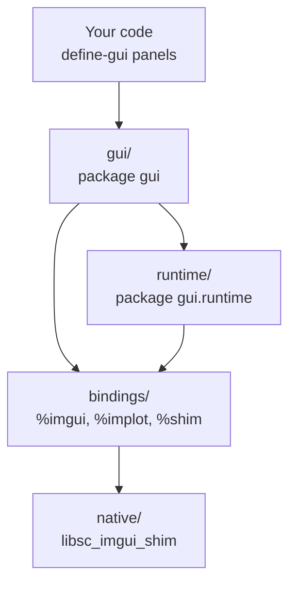

# src/: the Lisp code

All of sc-imgui's Lisp code lives here, in three directories. Each has its own README with file-by-file and package documentation.

| Directory | Purpose | Packages | ASDF system |
| --- | --- | --- | --- |
| [`bindings/`](bindings/README.md) | The foreign interface: loads the native library and binds its functions | `%imgui`, `%implot`, `%shim`, `sc-imgui.bindings` | `sc-imgui/bindings` |
| [`runtime/`](runtime/README.md) | The engine: frame loop, panel registry, error recovery | `gui.runtime` | `sc-imgui` |
| [`gui/`](gui/README.md) | The API you write against: panels, widgets, layout, plots, drawing | `gui` | `sc-imgui` |

## How they fit together

Dependencies run one way only. `gui` uses the runtime (to register panels and queue tasks) and the bindings (to call ImGui for widgets and drawing). The runtime uses the bindings (to drive the window and frames). The bindings know nothing about either. None of it depends on cl-collider.

## `bindings/`

Everything that crosses into C. Two of its files, `imgui.lisp` and `implot.lisp`, are generated from cimgui's and cimplot's JSON by `make bindings` and committed; never edit them by hand. The rest is hand-written:

- loading `libsc_imgui_shim` and reporting where it looked if it's missing;
- binding the shim's own functions (`native/shim.h`) as `%shim`;
- `optional-string`, the string type the generated code uses so that `nil` passes NULL.

The `%`-prefixed packages are low level: they mirror the C APIs one-to-one and do no checking. Code outside `src/` should normally use `gui` instead, dropping into `%imgui` or `%implot` only for something `gui` doesn't wrap yet.

It's a separate ASDF system so the generator and tests can load the bindings without the rest. See `generator/README.md` for how the generated files are produced.

## `runtime/`

What keeps the GUI running, from `start` to `shutdown`:

- the frame loop on SBCL's main thread, including the handoff to it, and the showing, hidden, and off states behind `start`, `stop`, and `shutdown`;
- the panel registry that `define-gui` adds to, with show, hide, failure marks, and refit after redefinition;
- drawing every registered panel each frame, isolating a panel that signals an error, and showing its failed window with a Retry button;
- the `call-in-gui-thread` task queue;
- error reports, sent to the stream captured at `start` so they reach the REPL.

It knows nothing about widgets or audio. Most of its exports are for `gui` and the tests; its user-facing functions are re-exported from `gui`.

## `gui/`

The public API. It provides:

- `define-gui`, `show`, `hide`, `remove`, `call-in-gui-thread`;
- scope and layout macros (`with-window`, `with-row`, `with-grid`, `with-section`, `with-id`, `with-style`, ...), which always close what they open, even after an error;
- place-based widgets (`slider`, `checkbox`, `combo`, `input-text`, ...), each with a `-value` function variant;
- ImPlot plots (`with-plot`, `plot-lines`, `plot-bars`, `plot-scatter`) that take Lisp vectors directly;
- draw-list primitives and interaction helpers for building custom widgets;
- re-exports of the runtime's `start`, `stop`, `shutdown`, `running-p`, `*ini-path*`, `*debug-on-error*`, and `main-thread-busy`, so `gui:` is the only package you need.

## Load order

The `sc-imgui` system loads `runtime/` before `gui/`, each file in the order listed in `sc-imgui.asd`, after its dependency `sc-imgui/bindings`. A new file must be added to that list in the right place.

## Related folders

- `native/`: the C++ shim library the bindings load (`native/README.md`).
- `generator/`: produces `bindings/imgui.lisp` and `bindings/implot.lisp` (`generator/README.md`).
- `tests/`: the test suites (`tests/README.md`).
- `examples/`: runnable demos using the `gui` API.
