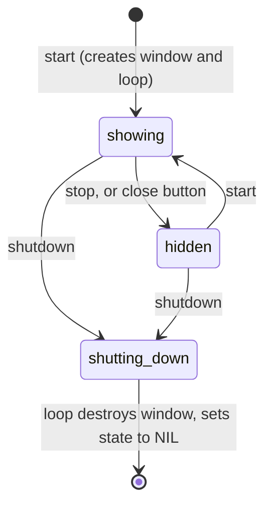

# src/runtime/: the `gui.runtime` package

Contents:

1. [Overview](#overview)
2. [Quick reference](#quick-reference)
3. [Core ideas](#core-ideas)
4. [Reference](#reference)
5. [File by file](#file-by-file)
6. [Lifecycle walkthroughs](#lifecycle-walkthroughs)
7. [Recipes](#recipes)
8. [Extending the runtime](#extending-the-runtime)
9. [Known limitations](#known-limitations)
10. [Gotchas](#gotchas)
11. [Tests](#tests)

## Overview

`gui.runtime` is the engine underneath `gui`. It owns:

- the GUI window and the **frame loop** that runs on SBCL's main thread;
- the **panel registry** that `gui:define-gui` adds to;
- drawing each registered panel every frame, and **isolating errors** so one broken panel can't take down the others or the window;
- the **task queue** behind `gui:call-in-gui-thread`;
- **error reports**, sent to the REPL that started the GUI.

It knows nothing about widgets, layout, or audio; those are in `src/gui/`. It talks to ImGui only to drive frames, to keep ImGui's state balanced around each panel, and to draw a failed panel's window.

Users normally never type `gui.runtime:`. Its user-facing exports (`start`, `stop`, `shutdown`, `running-p`, `*ini-path*`, `*debug-on-error*`, `main-thread-busy`) are re-exported from `gui`. The rest exist for the `gui` layer and the tests. See `src/README.md` for how the directories fit together.

## Quick reference

**Audience:** *user* = re-exported from `gui`; *gui* = used by the `gui` layer; *tests* = test hooks. **Threads:** *any* = safe from any thread; *main* = only on the GUI (main) thread.

| Area | Export | Kind | Audience | Threads |
| --- | --- | --- | --- | --- |
| [Lifecycle](#lifecycle) | `start`, `stop`, `shutdown`, `running-p` | functions | user | any |
| | `*ini-path*` | variable | user | set before `start` |
| | `main-thread-busy` | condition | user | |
| | `wake-loop` | function | gui | any |
| [Registry](#registry) | `gui-entry`, `make-gui-entry`, `gui-entry-p`, `gui-entry-name`, `gui-entry-function-name`, `gui-entry-visible`, `gui-entry-failure`, `gui-entry-refit` | struct | gui, tests | read only outside the registry |
| | `register-gui`, `unregister-gui`, `find-gui`, `set-gui-visible`, `mark-gui-failed`, `clear-gui-failure`, `registry-snapshot` | functions | gui | any |
| | `gui-refit-pending`, `clear-gui-refit` | functions | runtime | any |
| | `*refit-windows*` | variable | gui | main |
| [Drawing and recovery](#drawing-and-recovery) | `draw-registered-guis` | function | runtime, tests | main, inside a frame |
| | `*debug-on-error*` | variable | user | any |
| | `retry-panel`, `disable-panel` | restarts | user | |
| [Tasks](#tasks) | `enqueue-task` | function | gui | any |
| | `run-queued-tasks` | function | runtime, tests | main |
| [Reporting](#reporting) | `*report-stream*` | variable | user, tests | any |
| | `report-error` | function | runtime | any |
| [Test hooks](#test-hooks) | `%reset-registry` | function | tests | any |

## Core ideas

### The loop owns the main thread

macOS lets only a process's main thread drive windows, so the frame loop runs on SBCL's main thread. `start` hands it over with `sb-thread:interrupt-thread`: the main thread is interrupted and runs the loop. If the main thread is deferring interrupts at that moment (during a garbage collection or a long foreign call), the interrupt stays pending until it can be accepted, so the request is never lost. That's why `trivial-main-thread` was replaced: its queue could drop a request.

This only works if the REPL evaluates on a different thread. Under SLIME that needs `(setf swank::*main-thread-used* t)` in `~/.swank.lisp`. Creating the loop from the main thread itself signals `main-thread-busy`.

Once created, the loop keeps the main thread until `shutdown`. `stop` and the close button only hide the window, and the loop keeps processing events. Never letting the main thread go idle is what makes macOS remove a hidden window from the screen cleanly. See "macOS: the window must leave the screen before it is destroyed" in `native/README.md`.

### Requested state and actual state

`start`, `stop`, and `shutdown` never touch the window. They change the **requested** state, `*state*`, under `*loop-lock*`, and wake the loop. The loop, on the main thread, does the GLFW work and records whether the window is **actually** on screen in `*shown*`.



`*state*` is `nil` (no loop), `:showing`, `:hidden`, or `:shutting-down`. Only the loop sets it back to `nil`, when it exits.

### One pass of the loop

Each pass, on the main thread, with float traps masked:

1. Run queued `call-in-gui-thread` tasks.
2. Act on `*state*`:
    - `:shutting-down`: leave the loop.
    - `:showing`: show the window if it was hidden. If the close button was pressed, switch to `:hidden`. Otherwise begin a frame, draw every visible panel, and end the frame, which waits for the display (vsync, about 60 times a second).
    - `:hidden`: hide the window if it's showing, then wait for events for up to 0.5 s (`+hidden-wait+`). Requests wake it at once; the timeout only limits the delay if a wake-up is missed.
3. Repeat.

When the loop ends, for any reason, it shuts the window down and sets `*state*` to `nil` in `unwind-protect`.

### Panels are looked up by name every frame

The registry stores each panel's **function name**, not the function. Each frame, `draw-registered-guis` calls `(fdefinition function-name)`. Re-evaluating `gui:define-gui` redefines the function, so the next frame calls the new code. Nothing holds on to the old definition.

### Layers of error handling

| Where | What's caught | What happens |
| --- | --- | --- |
| A panel | any `error`, and `storage-condition` (stack or heap exhaustion) | The panel is marked failed and reported; other panels keep drawing. Its failed window appears with a Retry button. |
| Around every panel | anything the panel left open in ImGui | ImGui's error-recovery state, saved before the panel, is restored afterwards, so a half-finished panel can't nest the next one inside its window. |
| A task | any `error` | Reported with source `:task`; the remaining tasks still run. |
| The loop itself | any `error`, and `storage-condition` | Reported with source `:loop`; the window is shut down cleanly and the loop ends. `start` can be called again. |
| Reporting | everything | `report-error` never signals. An unprintable condition is described by its type; a dead stream falls back to `*error-output*`, then silence. |

## Reference

### Lifecycle

**`(start &key (width 1280) (height 800) (title "sc-imgui"))`** — Shows the GUI window and returns `t` at once, or `nil` if it's already showing. With no loop (the first time, or after `shutdown`), it requests a new window of `width` × `height` and hands the loop to the main thread; doing that from the main thread signals `main-thread-busy` and changes nothing. After `stop`, it shows the hidden window again with `title`, and this is allowed from any thread, including the main thread. Each `start` that shows the window sets `*report-stream*` to the caller's `*standard-output*`. If a `shutdown` is in progress, it first waits up to 5 s for it to finish.

**`(stop &key (wait t))`** — Requests the hidden state: the window is hidden (saving the layout to `*ini-path*`) and panels stop being drawn, while the loop keeps running tasks. Returns `t` if the window was showing, else `nil`. With `wait`, it waits up to 5 s for the window to be hidden, except on the main thread.

**`(shutdown &key (wait t))`** — Requests the end of the loop: the window is hidden, destroyed after a settling delay, and the main thread is released. Returns `t` if there was a loop, else `nil`. With `wait`, it waits up to 5 s for the loop to finish, except on the main thread. The registry is untouched.

**`(running-p)`** — True when the requested state is `:showing`, which is immediately after `start` returns, possibly before the window appears.

**`*ini-path*`** — Where ImGui saves window layout. Default `#p"sc-imgui.ini"`, merged with `*default-pathname-defaults*` when `start` creates the window; `nil` disables saving. Changing it has no effect until the window is next created.

**`main-thread-busy`** — Error signalled by `start` when it would have to create the loop from the main thread. Its report explains the SLIME setting and how to check which thread the REPL is on.

**`(wake-loop)`** — Wakes the loop if it's waiting for events. Safe from any thread, and does nothing when there's no window. `gui:call-in-gui-thread` calls it after queueing a task.

### Registry

The registry is an ordered list of entries plus an `equal` hash table from name to entry, both guarded by `*registry-lock*`. Every registry function takes the lock and is safe from any thread.

**`gui-entry`** — A struct with slots:

| Slot | Meaning |
| --- | --- |
| `name` | The panel's name; any object, compared with `equal`. `define-gui` uses the symbol. |
| `function-name` | The name of the function to call each frame. |
| `visible` | Default `t`. Hidden panels are skipped. |
| `failure` | `nil`, or the condition the panel failed with. Failed panels aren't called; their failed window is drawn instead. |
| `refit` | `nil`, or a token marking that the panel was redefined and its windows should refit to their contents. |

Treat entries as read-only outside the registry: change them through the functions below, which take the lock.

**`(register-gui name function-name)`** — Adds a panel at the end, or updates an existing one in place: it keeps its position and visibility, clears its failure, and gets a new refit token. Returns the entry.

**`(unregister-gui name)`** — Removes a panel. Returns `t` if it existed.

**`(find-gui name)`** — The entry for `name`, or `nil`.

**`(set-gui-visible name visible)`**, **`(mark-gui-failed name condition)`**, **`(clear-gui-failure name)`** — Change one slot. Each does nothing for an unknown name.

**`(registry-snapshot)`** — A fresh list of the entries in registration order. The loop draws from a snapshot, so registering or removing panels from another thread mid-frame is safe.

**`(gui-refit-pending name)`**, **`(clear-gui-refit name token)`** — The pending refit token, or `nil`; clear it only if it's still `token`. Using tokens means that if a panel is redefined again while a refit is pending, the newer refit isn't cleared by the older one.

**`*refit-windows*`** — True while a just-redefined panel is being called. `gui:with-window` reads it and asks ImGui to auto-fit the window that frame.

### Drawing and recovery

**`(draw-registered-guis)`** — Called by the loop between beginning and ending a frame. For each visible entry in a snapshot:

- If it has failed, it draws the failed window, titled `"<name> (failed)"`, showing the condition (up to 500 characters) and a Retry button that clears the failure.
- Otherwise it calls the panel with error isolation (see [Layers of error handling](#layers-of-error-handling)). If a refit is pending, the panel is called with `*refit-windows*` true, and the refit is cleared only if the panel returned normally, so a panel that fails right after redefinition still refits once it's fixed.

**`*debug-on-error*`** — Default `nil`. When true, a panel error enters the debugger instead of being caught, from inside the panel call so no outer handler sees it first, with two restarts:

- **`retry-panel`**: leave the panel enabled; it runs again next frame.
- **`disable-panel`**: mark the panel failed with the condition, and show its failed window.

The debugger runs on the main thread, so the window freezes until you choose a restart.

### Tasks

**`(enqueue-task thunk)`** — Adds `thunk` to the queue and returns it. Safe from any thread. Doesn't wake the loop; `gui:call-in-gui-thread` does both.

**`(run-queued-tasks)`** — Runs every queued task in the order queued, then returns how many ran. The queue is swapped out under its lock first, so tasks queued while running wait for the next pass. An error in a task is reported with source `:task` and the rest still run. Called by the loop at the start of each pass, before any frame begins.

### Reporting

**`*report-stream*`** — Where error reports go. Initially the `*standard-output*` at load time; each `start` that shows the window sets it, globally, to the caller's `*standard-output*`. Under SLIME that's the REPL, which is why reports appear there and not in `*inferior-lisp*`.

**`(report-error source condition &optional backtrace-string)`** — Writes `[gui] <source> failed: <condition>`, then the backtrace if given, and flushes. `source` is a panel name, `:task`, or `:loop`. Never signals: anything unprintable is replaced by a description, and if `*report-stream*` fails it tries `*error-output*`, then gives up silently. Panel reports include a 30-frame backtrace.

### Test hooks

**`(%reset-registry)`** — Empties the registry and the task queue. Used by `with-clean-registry` in the tests. Never call it while the GUI is in use.

**`*retry-button-centers*`** (internal) — Each frame, the screen position of each failed window's Retry button, so tests can click it.

## File by file

The `sc-imgui` system loads these first, before `src/gui/`, in this order:

| File | Contents | Lock |
| --- | --- | --- |
| `package.lisp` | The `gui.runtime` package and its exports. | |
| `registry.lisp` | The `gui-entry` struct, the registry list and table, all registry functions, `%reset-registry`. | `*registry-lock*` |
| `tasks.lisp` | The task queue: `enqueue-task`, `run-queued-tasks`, `%reset-tasks`. Tasks are kept newest-first and reversed when run. | `*task-lock*` |
| `report.lisp` | `*report-stream*`, `report-error`, and `%safe-princ`, which prints anything without signalling. | |
| `frame.lisp` | `*debug-on-error*`, `*refit-windows*`, `draw-registered-guis`. `%call-panel` calls one panel with error isolation and ImGui state recovery; `%draw-failed-window` draws a failed panel's window; `%backtrace-string` captures a backtrace. | |
| `loop.lisp` | The requested state and `start`, `stop`, `shutdown`, `running-p`, `main-thread-busy`, `wake-loop`. `%frame-loop` is the loop itself; `%run-on-main-thread` does the handoff; `%wait-while` is the bounded wait used by `start`, `stop`, and `shutdown`. | `*loop-lock*` |

No function holds two of the locks at once, so they can't deadlock against each other.

## Lifecycle walkthroughs

### The first `start`

1. **REPL thread:** `start` takes `*loop-lock*`, sees no loop, checks it isn't on the main thread, sets `*state*` to `:showing`, and sets `*report-stream*`.
2. **REPL thread:** it interrupts the main thread with the loop function, and returns `t`.
3. **Main thread:** when it next accepts interrupts, it enters `%frame-loop`, opens the window through `%shim:open-window` (which also creates the ImGui and ImPlot contexts and loads the layout from `*ini-path*`), sets `*shown*`, and starts drawing frames.

The main thread stays inside the loop until `shutdown`. Whatever it was doing before, typically sleeping in SLIME, resumes afterwards.

### `stop`

1. **REPL thread:** `stop` changes `*state*` from `:showing` to `:hidden`, wakes the loop, and waits until the window is hidden.
2. **Main thread:** on its next pass the loop calls `%shim:hide-window`, which saves the layout and hides the window, clears `*shown*`, and from then on waits for events instead of drawing.

### `start` after `stop`

1. **Any thread:** `start` changes `*state*` to `:showing`, records the title, sets `*report-stream*`, and wakes the loop.
2. **Main thread:** the loop calls `%shim:show-window` and resumes drawing frames. The same window comes back; no new window or context is created.

### The close button

1. **Main thread:** at the start of a showing pass, `%shim:should-close` reports the button press.
2. The loop switches `*state*` to `:hidden` itself, then behaves as after `stop`. `start` brings the window back.

### `shutdown`

1. **REPL thread:** `shutdown` changes `*state*` to `:shutting-down`, wakes the loop, and waits until `*state*` is `nil`.
2. **Main thread:** the loop sees `:shutting-down` and leaves. Its cleanup calls `%shim:shutdown`, which hides the window, keeps processing events until macOS has removed it, then destroys the window and contexts and terminates GLFW. It sets `*state*` to `nil`.
3. The main thread returns from the interrupt and is free again. The registry still holds every panel, so the next `start` shows them all.

### A panel error

1. **Main thread:** `%call-panel` saves ImGui's error-recovery state and calls the panel.
2. The panel signals an error. The handler captures a backtrace, marks the entry failed, reports it to `*report-stream*`, and unwinds out of that panel only. The `gui` scope macros' `unwind-protect` forms close what they opened as it unwinds.
3. ImGui's saved state is restored, popping anything still open.
4. The next panels draw normally. From the next frame, the failed panel isn't called; its failed window is drawn instead.
5. The failure clears when you press Retry, or re-evaluate the panel's `define-gui`, which calls `register-gui`.

A stack or heap exhaustion follows the same path, except the report is made after unwinding, to have room for it, and has no backtrace.

### A redefinition and its refit

1. **REPL thread:** `define-gui` redefines the function and calls `register-gui`, which clears any failure and stores a new refit token.
2. **Main thread:** the next frame calls the new function with `*refit-windows*` true, so each `gui:with-window` in it asks ImGui to fit the window to its contents. If the call returns normally and the token is unchanged, the refit is cleared.

### The window fails to open

1. **Main thread:** `%shim:open-window` returns nonzero, for example when GLFW can't create an OpenGL context. The loop reports `%shim:last-error` with source `:loop`.
2. The loop exits without calling `%shim:shutdown` (a failed open cleans up after itself) and sets `*state*` to `nil`. `start` can be called again.

## Recipes

### Send error reports somewhere else

`start` sets `*report-stream*`, so set it afterwards:

```lisp
(gui:start)
(setf gui.runtime:*report-stream*
      (open "gui-errors.log" :direction :output :if-exists :append :if-does-not-exist :create))
```

The next `start` that shows the window sets it back to the REPL. Close the file yourself when done.

### Debug a hard panel

```lisp
(setf gui:*debug-on-error* t)
```

The next error in any panel opens the debugger on the main thread; SLIME shows it in a debugger buffer. The window freezes while it's open. Inspect the backtrace and locals, then choose `RETRY-PANEL` to keep the panel running (fix the code first, or it fails again next frame) or `DISABLE-PANEL` to show its failed window. Avoid aborting to the top level: that unwinds out of the frame loop, which shuts the window down. Set `*debug-on-error*` back to `nil` when done.

### Check a panel from the REPL

```lisp
(let ((e (gui.runtime:find-gui 'saw-panel)))
  (when e
    (list :visible (gui.runtime:gui-entry-visible e)
          :failure (gui.runtime:gui-entry-failure e))))

(mapcar #'gui.runtime:gui-entry-name (gui.runtime:registry-snapshot))   ; every panel, in drawing order
```

A failed panel's condition is the object itself, so you can inspect it in SLIME, for example with `(inspect (gui.runtime:gui-entry-failure e))`.

### Run something between frames

For main-thread work that isn't drawing, such as changing ImGui's global style:

```lisp
(gui:call-in-gui-thread
 (lambda ()
   (%imgui:style-colors-light (cffi:null-pointer))))
```

It runs at the start of the next pass, also while the window is hidden. Don't draw widgets from a task; see [Gotchas](#gotchas).

### Drive the GUI from a script

Outside SLIME, the main thread must stay free for the loop, so make the calls from another thread and keep the main thread idle:

```lisp
(ql:quickload :sc-imgui)
(load "my-panels.lisp")
(bt2:make-thread (lambda () (gui:start)))
(loop (sleep 1))      ; the main thread accepts the loop and runs it
```

`tests/smoke.lisp` does this in full, including a watchdog and exiting when done.

## Extending the runtime

Keep these properties, which the tests and the macOS behavior depend on:

- **Window work happens only on the main thread, inside `%frame-loop`.** Public functions only change requested state under `*loop-lock*` and call `wake-loop`.
- **Every request wakes the loop,** or a hidden loop may sleep for up to `+hidden-wait+`.
- **The loop's cleanup always runs:** keep `%shim:shutdown` and resetting `*state*` in the `unwind-protect`.
- **Nothing a panel does can stop the loop** except exhausting the process; panel errors must stay inside `%call-panel`.
- **Reporting never signals.**

Where common changes go:

- **A per-frame step,** such as polling an OSC queue: in the `:showing` branch of `%frame-loop`, between `begin-frame` and `end-frame` if it draws, or beside `run-queued-tasks` if it doesn't. Wrap it in its own error handling, or an error there ends the loop.
- **A new requested state:** add it to `*state*`'s documented values, to the `ecase` in `%frame-loop`, and to the transitions in `start`, `stop`, and `shutdown`. Update the state diagram above.
- **A new registry field:** add a slot to `gui-entry` with a default, and a locked accessor function; don't let callers write slots directly.
- **Live reporting of ImGui assertions:** after `draw-registered-guis`, compare `(%shim:assert-count)` with the last value seen, report `(%shim:last-assert)` through `report-error` with source `:imgui`, and clear. Add a `frame` test. (Noted as an improvement in `native/README.md`.)

Then add tests to the `registry`, `frame`, or `loop` suite, and run `make smoke`.

## Known limitations

- **One OS window.** Multiple windows would use ImGui's viewports, which are disabled. See the decision log in `native/README.md`.
- **ImGui assertions aren't reported live.** They're recorded silently during a session; check `(%shim:assert-count)` by hand. See [Extending the runtime](#extending-the-runtime).
- **Continuous redraw.** While showing, the loop draws every frame, even when nothing changes. That's deliberate for live meters and scopes; the cost is small with vsync, but there's no idle throttling.
- **Bounded waits.** `start`, `stop`, and `shutdown` wait at most 5 s. If the main thread is busy longer (a long foreign call, a debugger open on it), they return before the change has happened, and `start` may report the GUI already running or not.
- **No panel reordering.** Panels draw in registration order, and redefinition keeps their place. To move one to the end, `gui:remove` it and evaluate its `define-gui` again.
- **No per-panel timing.** A slow panel slows the whole frame, and nothing reports which panel is slow.

## Gotchas

### The last `start` decides where reports go

`*report-stream*` is set globally by each `start` that shows the window, not bound per thread. With two SLIME connections, reports go to whichever last called `start`. If that connection closes, its stream is dead, and reports fall back to `*error-output*`, usually the `*inferior-lisp*` buffer. Calling `start` again from a live REPL redirects them there.

### `*debug-on-error*` freezes the window

The debugger runs on the main thread, which is the frame loop. Nothing draws until you choose a restart, and on macOS the window may show a spinning cursor. Aborting to the top level from that debugger unwinds out of the loop and shuts the window down.

### Tasks run outside frames

Tasks run at the start of each pass, before `begin-frame`, so drawing widgets from one is ImGui misuse. They also run while the window is hidden. An error in a task is reported but doesn't mark any panel failed.

### Only errors and resource exhaustion are caught per panel

Panels catch `error` and `storage-condition`. Other conditions behave differently:

- **Warnings** aren't caught. `warn` prints to the main thread's `*error-output*`, usually `*inferior-lisp*`, not the REPL.
- **Other serious conditions** that aren't errors escape the panel and the loop's handlers. The loop's cleanup still shuts the window down, and the condition reaches whatever handles it on the main thread. This is rare in panel code.
- **Signals handled by your own code** inside a panel behave normally.

### `stop` and `shutdown` don't wait on the main thread

Called from a panel or a task, they return immediately: waiting there would block the loop that has to act on them. The change takes effect on the next pass.

### `start` on the main thread depends on the state

Creating the loop from the main thread signals `main-thread-busy`. Showing an existing hidden window from the main thread is allowed, since the loop already exists. From inside a panel while showing, `start` just returns `nil`.

### Plain `defun` also takes effect, but differently

Because panels are looked up by name, redefining a panel's function with `defun` changes it on the next frame too. But only `define-gui` calls `register-gui`, so a plain `defun` doesn't clear a failure or refit windows.

### Panel names are compared with `equal`

Any object can be a name, but two `equal` names are the same panel: registering the second replaces the first. Names that are fresh objects each time, such as `(list 'a)`, still match each other.

### The registry outlives the loop

`shutdown` doesn't clear the registry. Every panel reappears on the next `start`, including failed ones, which come back still failed. Use `gui:remove` to drop a panel for good.

### Drawing order is registration order

Panels draw in the order they were first registered, and redefinition keeps their position. ImGui windows are separate, so this rarely shows, except for which window is on top when windows first appear.

## Tests

| Suite | Covers |
| --- | --- |
| `registry` | Registration, in-place redefinition, failure clearing, show and hide, concurrent registration from 8 threads, the task queue surviving errors (including unprintable ones), refit tokens |
| `frame` | Healthy and hidden panels, error isolation (including unbalanced ImGui state and runaway recursion), reports to the captured stream, the Retry button, `*debug-on-error*` and its restarts, refits, reporting that never signals |
| `loop` | `stop` and `shutdown` with no loop, state transitions (set by hand, without a window), `main-thread-busy`, a failed window open, `start` from a panel, and the main-thread handoff surviving deferred interrupts |
| smoke test | The real window: start, redefinition, errors, stop and start, the close button, shutdown and restart |

Which tests cover each walkthrough:

| Walkthrough | Tests |
| --- | --- |
| First `start` | `loop`: `start-on-main-thread-signals`, `main-thread-handoff-survives-deferred-interrupts`; smoke check 1 |
| `stop`, `start` after `stop` | `loop`: `stop-hides-a-showing-window`, `start-shows-a-hidden-window-even-on-the-main-thread`; smoke check 5 |
| Close button | smoke check 6 |
| `shutdown` | `loop`: `shutdown-without-a-loop`, `shutdown-ends-a-hidden-or-showing-loop`; smoke check 6 |
| Panel error | `frame`: `failing-panel-is-isolated`, `unbalanced-panel-does-not-break-next-frame`, `runaway-recursion-is-isolated`, `report-goes-to-captured-stream`, `retry-button-clears-failure`; smoke check 4 |
| Redefinition and refit | `registry`: `redefine-marks-refit`; `frame`: `redefinition-refits-windows`, `fixed-failed-panel-refits`; smoke check 3 |
| Window fails to open | `loop`: `frame-loop-reports-open-failure` |

Two `loop` tests, `start-from-panel-while-running-returns-nil` and `main-thread-handoff-survives-deferred-interrupts`, need the run to be on the main thread, as `make test` is. From the SLIME REPL they're skipped. See `tests/README.md`.
